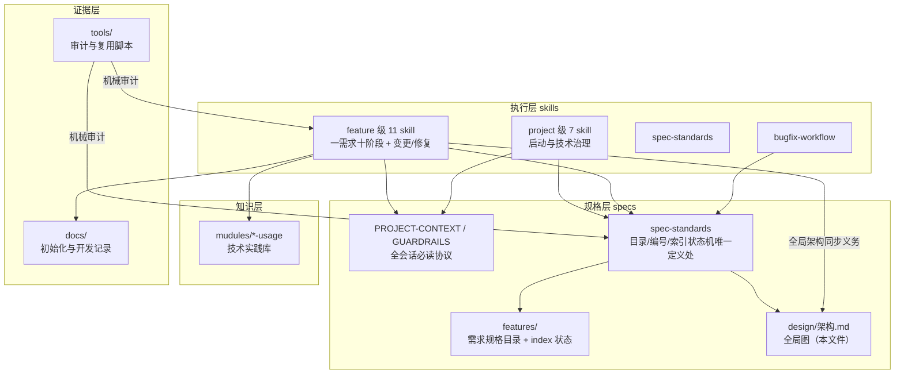

# 全局架构（specs/design/架构.md）

> 依据 speceverything-spec-standards §9 建立。本仓库冷启动期间从未建立，按「漂移即修、不得再拖」条款由 F001（审计变异测试）技术设计顺带建立。

## 模块职责（各一句话）

- **规格层 specs**：唯一事实源——协议（PROJECT-CONTEXT/GUARDRAILS）、规范（spec-standards）、需求规格目录与索引状态、全局架构图。
- **执行层 skills**：流程执行器——project 级治理启动、feature 级十阶段交付、bugfix 修复；只消费规格、不定义规格（唯一定义处纪律）。
- **知识层 mudules**：技术栈最佳实践库，被 tech-design 检索引用，不含流程规则。
- **证据层 docs + tools**：开发过程记录的落点与机械验证脚本；tools 审计 skills 与 specs 的机械可验性质（引用、模板、路径、预算）。

## 依赖方向

规格层被所有层消费、不反向依赖；执行层依赖规格层与知识层；证据层 tools 只读扫描规格层与执行层，不被任何 skill 依赖。**禁止方向**：规格层引用具体 skill 实现细节（引用「唯一定义处」除外，那是登记而非依赖）。

## 变更记录

| 日期 | 需求编号 | 变更 |
|------|---------|------|
| 2026-11-27 | F001 | 初始建立（spec-standards §9 义务，tech-design 顺带建立条款） |
