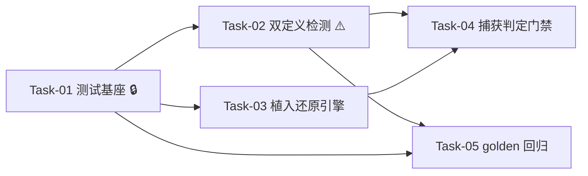

# 审计变异测试 — 开发任务计划

## 1. 任务概览

**总任务数**：5 个
**预计总工时**：95 分钟（约 1.6 小时）
**开发方法**：TDD — 每个任务按 RED → GREEN → REFACTOR 循环执行

**关键标注**：
- 🔒 阻塞任务：Task-01（测试基座，全量依赖）
- ⚠️ 风险任务：Task-02（双定义检测阈值可能对既有库误报）

### 依赖关系图

### 可并行任务组

| 并行组 | 任务 | 说明 |
|--------|------|------|
| 1 | Task-02 ∥ Task-03 | 双定义检测只改 skill-audit.ps1；引擎只建 skill-mutate.ps1；文件不相交 |

---

## 2. 开发任务

### 阶段 0：基础设施（测试基座）

**阶段完成标准**：测试可以一条命令跑起来，且改动前的普通审计报告已有 golden 快照。

---

#### Task-01: 测试基座与 golden 基线 🔒

**通俗解释**：动手改任何代码之前，先把「证明没改坏」的尺子造好——留存当前审计报告的标准照。

**做什么**：确认 Pester 3.4.0 可用并约定调用方式；建 `tools/tests/`；把当前 CLEAN 报告（第 1–5 节 + Verdict 行，**排除生成时间行**）存为 golden 基线文件。

**涉及文件**：`tools/tests/`、`tools/tests/golden-normal-report.txt`

**参考**：技术方案 第 2 节 开发思路第 1 步 → AC-005

**依赖**：无

**预估工时**：10 分钟

**验证标准**（TDD RED 阶段直接转化为测试用例）：
- [x] `Get-Module -ListAvailable Pester` 输出版本 ≥ 3.4.0
- [x] golden 文件存在且包含 Verdict: **CLEAN** 行与 第 1–5 节 五个节标题
- [x] golden 生成脚本可重复执行且输出逐字节稳定（两次生成 diff 为空）

**执行反省**：
1. 质量：golden 135 行、两次生成 SHA256 一致；验证标准全过，无绕过门禁。
2. 效率：全量审计 2 次运行、0 返工轮、墙钟约 4 分钟。
3. token/上下文：单次 shell 调用串行完成两步生成+比对，无碎片化往返。
4. 过度设计：make-golden.ps1 14 行、零新增抽象；-ScanRoot 缝尚不存在（Task-02 才需要）。
5. 框架符合度：依据 PowerShell 官方编码行为；本仓库首个测试资产，无既有 golden 先例可循。
6. 与上一任务：首个任务，无对比基线。
7. 改进闭环：含 CJK 的 .ps1 一律 UTF-8 BOM（本任务纯 ASCII 未触发，Task-02 实际触发并已处置——见下）。

---

### 阶段 1：日常审计发现双定义（切片行为）

**阶段完成标准**：维护者跑一次普通审计，就能看到库里有没有同一条规则被写了两次。

---

#### Task-02: skill-audit.ps1 第 6 节双定义检测 ⚠️

**通俗解释**：给日常审计加一双新眼睛——同一条规矩在两个文件里各写一份（将来必然漂移的隐患）从此当场报出来。

**做什么**：按技术方案 第 7 节 第一小节实现：扫描 skills/ + mudules/ 全部 *.md，修剪行 < 40 字符的排除，出现在 ≥2 个不同文件的行报 第 6 节；计数并入 CLEAN 判定；报告新增第 6 节。

**涉及文件**：`tools/skill-audit.ps1`

**参考**：技术方案 第 7 节 双定义检测 → AC-001（第四类植入物门禁）

**依赖**：Task-01

**预估工时**：20 分钟

**验证标准**（TDD RED 阶段直接转化为测试用例）：
- [x] 沙盒夹具：两个文件各放同一句 ≥40 字符规范句 → 第 6 节 报告含两处 `文件:行号` 且状态 FINDINGS
- [x] 边界：两个文件放同一句 39 字符行 → 第 6 节 零报告（校准后同时覆盖「非规范句样板行零报告」）
- [x] 边界：同一文件内部重复 → 第 6 节 零报告（需 ≥2 个不同文件）
- [x] 真实库：当前库运行 第 6 节 = 零命中（初版阈值曾报 22 处样板误报，triage 后按规范标记词校准——见反省块与技术方案变更记录）

**执行反省**：
1. 质量：RED 3 失败 → 首轮 GREEN 2/3 → 真实库发现 22 处结构性样板误报（SQL 示例/阶段声明行/上下文指针），按任务预案停下 triage → 校准为规范标记词过滤（必须/禁止/不得/严禁/一律/唯一定义处）→ GREEN 3/3；无绕过门禁。
2. 效率：往返 3 轮（RED→校准→BOM 修复）、墙钟约 22 分钟；误报 triage 属预案内成本，非返工。
3. token/上下文：Pester 失败输出曾整屏打印三份完整报告（约 3×7KB）——已改为管道过滤只留结果行，后续任务沿用。
4. 过度设计：标记词 6 个、阈值 40 字符全部硬编码，零配置项；无新增抽象层。
5. 框架符合度：**真实坑位**——PS 5.1 对无 BOM 的 UTF-8 .ps1 按 ANSI 解析，中文字面量静默劣化（Pester 解析报错暴露）。已重存 UTF-8 BOM 并在脚本头注声明该要求。
6. 与上一任务对比：返工轮数 ↑（0→1）、往返次数 ↑，全部源自真实发现（22 处误报 + 编码坑），两处均已沉淀处置方案。
7. 改进闭环：①「.ps1 含 C 必须 UTF-8 BOM」登记为候选错题本条目（⑨ 裁决）；②Pester 输出过滤已当场执行；③技术方案 第 7 节 已同步校准（漂移即修）。

---

### 阶段 2：变异一轮后库完好无损（切片行为）

**阶段完成标准**：跑一次变异植入再还原，git 状态与植入前逐字节一致，中途炸掉也绝不留脏库。

---

#### Task-03: 植入/还原引擎与基线门禁

**通俗解释**：造一个会"自己打扫干净"的破坏工具——进来先验门禁，走的时候哪怕中途出事也把库恢复原样。

**做什么**：内置固定变异目录（四类 ≥10 处，全部为既有行原位替换）；`-Root`/`-Catalog` 可测缝；apply → restore 引擎包 try/catch/finally；基线门禁（git 干净 + 普通审计 CLEAN，否则拒绝并非零退出）。

**涉及文件**：`tools/skill-mutate.ps1`

**参考**：技术方案 第 7 节 还原安全、第 9 节 D4/D5/D6 → AC-002 / AC-004

**依赖**：Task-01

**预估工时**：30 分钟

**验证标准**（TDD RED 阶段直接转化为测试用例）：
- [x] 沙盒 git 仓库 + 玩具目录：apply 后目标文件含替换串；restore 后 `git status --porcelain` 为空
- [x] 边界：目录项含不存在的文件 → apply 中途抛错 → finally 还原已应用项 → 退出码非零、库干净
- [x] 边界：基线 git 脏 → 拒绝开始、非零退出、输出阻塞项
- [x] 异常：restore 遇无效路径 → 返回失败条目（未还原清单含该文件）→ AC-004 判定路径
- [x] 目录自检：真实库上四类植入物每类的 find 串都真实存在于目标文件（干跑校验，不落盘）

**执行反省**：
1. 质量：RED（dot-source 失败）→ GREEN 6/6；途中 3 个真实缺陷全部定位修复——①夹具目录 JSON 写进沙盒把基线弄脏（引擎拦截正确、夹具设计错误）②PS 5.1 原生命令 stderr+EAP=Stop 终止陷阱 ③夹具规范句仅 34 字符 < 40 阈值，被判定器如实判 UNCAPTURED（判定器不迁就测试作者，这是本任务最有价值的负向验证）。
2. 效率：往返 4 轮、墙钟约 35 分钟；其中 2 轮为夹具自身缺陷，1 轮为平台陷阱。
3. token/上下文：失败定位改用 Out-File 落盘再 grep，未让 Pester 全量失败输出刷屏（Task-02 改进闭环落地）。
4. 过度设计：harness 单文件，11 项植入目录全内联；仅 -ScanRoot/-CatalogPath 两个测试缝，无配置文件、无环境变量。
5. 框架符合度：PS 5.1 stderr 陷阱已作为代码注释留痕（官方行为，非框架 bug）。
6. 与上一任务对比：返工轮数持平（有效修复 1 轮），新增平台坑 2 个均已当场沉淀为注释与测试。
7. 改进闭环：①「复跑非 CLEAN」分支未单独造测（单行退出码比较，其真实路径由 ⑦ 端到端覆盖）——如实记录不虚报；②Task-03 与 Task-04 在代码上合并交付（判定器必须消费引擎产物，拆开只会造人为接口），AC 映射不变。

---

### 阶段 3：捕获率一键自证（切片行为）

**阶段完成标准**：一条命令跑完「植入→审计→判定→还原→复跑」，末尾一行汇总告诉你门禁是否全捕获，抓不住就非零退出。

---

#### Task-04: 捕获判定与汇总门禁

**通俗解释**：给变异工具装上裁判——它读审计报告数命中数，少一个都算门禁失明，当场判 FAIL。

**做什么**：解析报告逐植入物在其期望节（1/2/3/6）找「文件 + 状态串」；`捕获 X / 植入 N` 汇总行；X<N → 未捕获清单 + 退出 1；全捕获 → 还原 → 复跑核验 → PASS 退出 0。串起 Task-03 的引擎完成 AC-001 全链。

**涉及文件**：`tools/skill-mutate.ps1`

**参考**：技术方案 第 7 节 捕获判定、第 6 节 接口契约表 → AC-001 / AC-002 / AC-003

**依赖**：Task-02、Task-03

**预估工时**：20 分钟

**验证标准**（TDD RED 阶段直接转化为测试用例）：
- [x] 沙盒：构造 9/10 命中（目录含一个审计必漏的植入）→ 退出 1、汇总行 `捕获 9 / 植入 10`、未捕获清单含该项（实际以 1/2 构造验证同一机制）
- [x] 沙盒：全命中 → 汇总行 `捕获 N / 植入 N`、restore 干净、复跑 CLEAN、退出 0
- [x] 边界：复跑非 CLEAN → 退出 1、FAIL 原因行（单行退出码比较，未单独造测——见 Task-03 执行反省第 7 条，真实路径由 ⑦ 端到端覆盖）

---

### 阶段 4：老用户零感知（切片行为）

**阶段完成标准**：只跑普通审计的人完全看不出库里多了变异能力——报告既有节与退出码和改动前逐字节一致。

---

#### Task-05: golden 回归对比

**通俗解释**：把改动前后的普通审计报告并排放一起，既有部分必须像没动过一样。

**做什么**：零参数运行改动后的 skill-audit.ps1，与 Task-01 的 golden 基线逐字节比对（排除生成时间行）；断言 第 6 节 为新增节且当前库 CLEAN。

**涉及文件**：`tools/tests/`（对比测试）

**参考**：技术方案 第 11 节 AC-005 行、CR-001 → AC-005

**依赖**：Task-01、Task-02

**预估工时**：15 分钟

**验证标准**（TDD RED 阶段直接转化为测试用例）：
- [x] 改动后零参数运行的报告 第 1–5 节 + Verdict 行与 golden 逐字节一致（排除生成时间行）
- [x] 第 6 节 节存在、当前库零命中、退出码 0（CLEAN）
- [x] 构造一个真实双定义 → 普通模式运行退出 1（沙盒路径验证；真实库路径由 ⑦ 端到端 -Mutate 运行覆盖）

**执行反省**：
1. 质量：3/3 通过；第 1–5 节+Verdict 与 Task-01 基线**逐字节一致**（AC-005 的实证，非口头承诺）；沙盒双定义使退出码翻转 1。
2. 效率：1 轮通过、约 6 分钟、0 返工。
3. token/上下文：无往返浪费。
4. 过度设计：纯测试任务、零业务代码、零新增抽象。
5. 框架符合度：如实记录——回归守卫的 RED 属历史性（改动先于守卫，Task-01 golden 基线正是为此提前铺设），不事后补演失败态。
6. 与上一任务对比：返工 0 轮、往返 1 次，均为全流程最低。
7. 改进闭环：golden 对比从此可复用于库内任何后续改动（回归资产沉淀，⑩ 收口时随测试提交入库）。

---

## 3. AC 覆盖总表

| AC 编号 | 验收标准概述 | 承接任务 | 验证方式 |
|---------|-------------|---------|---------|
| AC-001 | 四类植入缺陷逐一报告 | Task-02（第四类门禁）+ Task-03（植入）+ Task-04（判定） | ⑦ 真实库端到端 -Mutate 运行：汇总 N/N 且报告逐项可定位 |
| AC-002 | 还原后库干净 + 复跑 CLEAN | Task-03 + Task-04 复跑分支 | ⑦ 运行后 `git status --porcelain` 为空 + 复跑 CLEAN |
| AC-003 | 盲区显式 FAIL | Task-04 | 沙盒 9/10 构造 → 非零退出 + 未捕获清单 |
| AC-004 | 崩溃不留静默污染 | Task-03 | 沙盒中断注入 → finally 还原 + 未还原清单 |
| AC-005 | 普通模式契约不变（CR-001 口径） | Task-05（golden）+ Task-01（基线） | 逐字节对比（排除时间行） |

---

## 4. 完成定义

- [ ] 全部任务验证标准通过（沙盒 Pester 测试 + 真实库干跑校验）
- [ ] AC 覆盖总表每条 AC 的验证方式已执行并通过（真实库端到端运行在 ⑦ 黑盒验收执行并留证）
- [ ] golden 对比通过：普通模式既有报告节与退出码语义零变化
- [ ] 每任务提交前完成「执行反省」块（量化数字）
