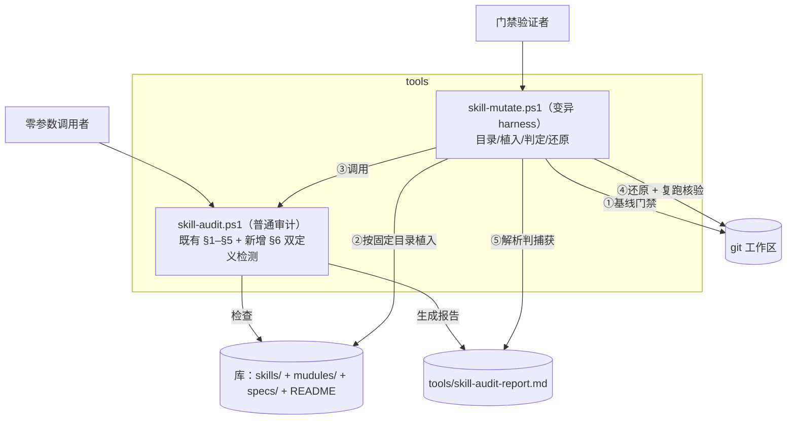
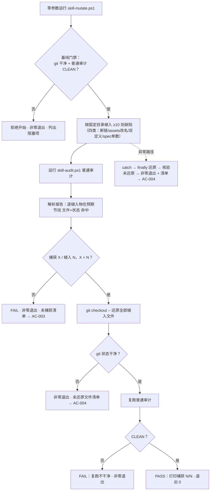

# 审计变异测试 — 技术设计文档

## 1. 设计概要

**功能描述**：为审计门禁建立变异测试能力——一条命令植入四类已知缺陷、验证审计逐项捕获、自动还原、给出捕获率门禁判定；同时为普通审计补上「双定义检测」这道缺失的门禁。

**影响范围**：`tools/skill-audit.ps1`（新增检查节）、`tools/skill-mutate.ps1`（新增）、`tools/tests/`（新增测试目录）。不触及 skills/ 任何文档。

**技术难点**：无。全部为确定性文本操作与退出码契约。

**外部依赖**：git（还原引擎）、Pester 3.4.0（Windows PowerShell 5.1 内置）。

---

## 前置检索留痕（mudules 未命中 PowerShell）

`mudules/` 仅有 abp/mysql/wpf 三个 usage skill，未命中 PowerShell。官方文档检索结论：Pester 为 PowerShell 官方测试框架（Microsoft 文档），PS 5.1 内置 3.4.0，断言用 v3 口径（`... | Should Be ...` / `Should Throw`）；脚本入口用 `param()`。`specs/技术栈.md` 缺失，经用户裁定走快车道：本仓库工具栈显式记录为 **Windows PowerShell 5.1 + Pester 3.4.0 + git**，建议项目级基线文档由 ⑨ 复盘决定补建。

---

## 2. 开发思路（强制）

**实现路径**：
1. 先落数据基线：捕获当前普通审计的 golden 报告（§1–§5 + Verdict，排除生成时间行），作为回归保护锚点（AC-005 的可验证形态）
2. 给 skill-audit.ps1 增加第 6 节「双定义检测」——库级新门禁，普通模式常驻
3. 新建 tools/skill-mutate.ps1：基线门禁 → 按固定目录植入 → 调用普通审计 → 解析报告逐项判捕获 → git 还原 → 复跑核验 → 捕获率汇总判定
4. golden 对比收口：证明既有报告节与退出码语义零变化

**依赖关系**：1 → 2 → 4 与 1 → 3 → 4；2 与 3 可并行。

**复用与融入**：完全复用既有审计的报告行格式（`| 文件:行 | ... | **状态** |`）作为捕获判定的解析目标——报告格式是既定契约，不另造结构。变异目录的植入点全部取自真实库文件的现成行（断链引用、assets 引用、规范句），不虚构内容。

**主要风险**：双定义检测对既有库产生误报（阈值不当）→ 阈值定为「修剪后行长度 ≥ 40 字符且出现在 ≥2 个不同文件、扫描范围限 skills/ 与 mudules/」，验收时以当前库零误报为通过条件，有命中即按发现处置。

---

## 3. 架构图（强制）

**图注**：本次**新增**节点 = M（skill-mutate.ps1 整体）与 A 的 §6 检查节；其余节点与关系为既有结构。A 的 §1–§5 逻辑零改动（决策 D3）。

---

## 4. 数据流程图（强制）

**数据流说明**：植入物形态为「文件 × 查找串 × 替换串」三元组，全部是对既有行的原位替换（不新建文件），还原因此恒可由 git checkout 完成；任一环节抛错（如目录项指向不存在文件）走 catch→finally，还原已应用项后核验，残留即报非零退出。捕获判定读的是报告文本行，不侵入检查代码。

---

## 5. 数据库设计

无需数据库——审计对象是 Markdown 文本库，唯一状态即 git 工作区，还原引擎就是 git 本身。

---

## 6. 接口契约（CLI）

### `powershell -File tools\skill-audit.ps1`（普通模式，零参数）

**描述**：既有审计，新增 §6 双定义检测。退出码语义不变：0 = CLEAN，1 = FINDINGS → AC-005

### `powershell -File tools\skill-mutate.ps1`（变异模式，零参数）

**描述**：一条命令完成自证全流程 → AC-001 / AC-002 / AC-003

**输出契约**：

| 场景 | 退出码 | 必含输出 | 对应 AC |
|------|--------|---------|---------|
| 全捕获 + 还原干净 + 复跑 CLEAN | 0 | `捕获 N / 植入 N` + PASS | AC-001, AC-002 |
| 任一植入物未捕获 | 1 | `捕获 X / 植入 N` + 未捕获清单（文件:期望节） | AC-003 |
| 还原后仍有残留 / 还原失败 | 1 | 未还原文件清单 | AC-004 |
| 基线不满足 | 1 | 阻塞项清单（git 状态 / 审计结果） | AC-002 前置 |
| 复跑不 CLEAN | 1 | FAIL 原因行 | AC-002 |

**可测缝（默认不变）**：`-ScanRoot <路径>`（默认 = 脚本上级目录）与 `-CatalogPath <清单文件.json>`（默认 = 内置固定目录）两个可选参数仅供测试沙盒使用；零参数调用行为与真实库绑定 → 决策 D6。（CR 后修正：原稿写 `-Root`/`-Catalog`，实现改为 `-ScanRoot`/`-CatalogPath`——`$Root` 与脚本内 `$root` 在 PS 大小写不敏感下同名冲突，且 CLI 内联 JSON 转义不可行改走文件路径。）

---

## 7. 核心逻辑

### 双定义检测（skill-audit.ps1 §6）→ AC-001（第四类植入物的既有门禁）

**触发条件**：普通模式与变异模式均运行（变异模式通过调用普通审计间接触发）。

**处理流程**：
1. 扫描 `skills/` 与 `mudules/` 下全部 `*.md`，逐行修剪，过滤长度 < 40 字符的行与**不含规范标记词**（必须/禁止/不得/严禁/一律/唯一定义处）的行
2. 以「修剪行文本 → 出现文件集合」建索引；出现在 ≥2 个不同文件的行即为双定义候选
3. 每个候选输出一行：两处 `文件:行号` + 行文本摘要（≤60 字符）
4. 命中计入 FINDINGS（CLEAN 判定把该计数并入总 clean 条件）

**阈值依据**：40 字符排除表格骨架与短标题；**规范标记词过滤是 Task-02 首跑证据驱动的校准**——无过滤时真实库命中 22 处全部为结构性样板（mudules 参考文档的 SQL/代码示例、各 skill 的阶段声明与上下文指针行），无一属于规则双定义；规则漂移风险存在于含标记词的规范句（已知真实案例：错题本条目格式双定义，含「必须」）。范围排除 specs/ 与 README（它们合法引用/摘录规则，唯一定义处纪律只约束 skills/mudules 正文）。

### 捕获判定（skill-mutate.ps1）→ AC-001 / AC-003

**处理流程**：
1. 植入目录每项登记：`文件`、`期望报告节`（1/2/3/6）、`期望状态串`（**BROKEN**/**MISSING**/文件名）
2. 审计运行后逐项在对应节中查找「该文件路径 + 期望状态串」的行
3. 未命中项进未捕获清单；`X < N` → 汇总行 + 退出 1，禁止静默成功 → AC-003

### 还原安全（skill-mutate.ps1）→ AC-002 / AC-004

**处理流程**：
1. 基线门禁先行：`git status --porcelain` 非空或普通审计非 CLEAN → 拒绝开始（保证 git checkout 还原语义成立）
2. apply → audit → restore 全程包在 try/catch/finally；finally 执行还原并核验
3. 还原后 `git status --porcelain` 仍有涉及文件 → 非零退出 + 未还原清单 → AC-004

---

## 8. 现有代码改动

| 模块 / 文件 | 改动内容 | 原因 | 对应 AC |
|-------------|---------|------|---------|
| `tools/skill-audit.ps1` | 末尾新增 §6 双定义检测与报告节；clean 判定并入该计数 | 补门禁盲区（任务书 Phase 1：盲区先补门禁） | AC-001 |
| `tools/skill-mutate.ps1` | 新建：目录 + 植入/还原引擎 + 捕获判定 + 汇总门禁 | 变异自证主体 | AC-001~004 |
| `tools/tests/` | 新建：Pester 测试目录（沙盒夹具） | TDD 载体 | 全部 |

---

## 9. 技术决策

### D1 双脚本 vs 单脚本加 -Mutate 开关

**背景**：变异能力可以并入 skill-audit.ps1（加开关参数）或独立成 skill-mutate.ps1。
**选项**：A: 单脚本加开关 — 少一个文件；B: 独立 harness 脚本 — 普通模式零改动面。
**结论**：选 B。普通模式（AC-005 的保护对象）与变异能力物理隔离，回归风险最小；代价仅是多一个文件。

### D2 Pester 3.4.0 vs 安装 Pester 5

**背景**：环境内置 Pester 3.4.0（v3 语法，已过时）；Pester 5 需 PSGallery 安装。
**结论**：用内置 3.4.0——零安装、离线可用、断言能力足够。shortcut: Pester 3.4 语法（Should Be / Should Throw）与 v5 不兼容；升级时机 = 仓库引入 CI 或需要 v5 高级特性时。

### D3 捕获判定 = 解析报告文本 vs 重构审计内部函数复用

**背景**：判捕获需要拿到检查结果：改审计脚本内部结构（函数化）或解析它生成的报告。
**结论**：解析报告——报告行格式是我们自己生成的既定契约，解析确定性可靠；既有检查代码零改动，回归风险归零。代价：报告格式将来变更时需同步判定器（同仓库双文件，可接受）。

### D4 变异目录 = 脚本内固定清单 vs 外部清单文件

**结论**：固定清单硬编码——可复现性是硬需求（AC-001 Given），外部文件反而引入路径漂移风险。

### D5 还原机制 = git checkout vs 备份副本

**结论**：git checkout -- 按文件还原——仓库自身 VCS 即还原引擎，与 AC-002「git 工作区无残留」直接对齐；前置是基线门禁保证工作区干净。

### D6 -ScanRoot / -CatalogPath 测试缝

**背景**：变异测试不能在开发中的脏工作区跑（基线门禁会拒绝），测试必须用沙盒库；而固定目录指向真实文件。
**结论**：给 skill-mutate.ps1 加 `-ScanRoot`/`-CatalogPath` 可选参数（默认 = 真实库 + 内置目录），这是 AC-004 路径可确定性测试的最小缝；skill-audit.ps1 加 `-ScanRoot`（沙盒夹具所需）；零参数行为不变，不构成契约破坏。（参数命名从原稿 `-Root`/`-Catalog` 修正而来：`$Root` 与脚本内 `$root` 大小写不敏感冲突 + CLI 内联 JSON 转义不可行——编码复核 C1#1 处置。）

---

## 11. AC 覆盖总表

| AC 编号 | 验收标准概述 | 实现位置 |
|---------|-------------|---------|
| AC-001 | 四类植入缺陷逐一报告 | 目录 + 植入（§7 还原安全·skill-mutate）+ 双定义检测（§7 第一小节）+ 捕获判定（§7 第二小节） |
| AC-002 | 还原后库干净 + 复跑 CLEAN | §7 还原安全 1、3 步 + 数据流图还原分支 |
| AC-003 | 盲区显式 FAIL | §7 捕获判定第 3 步 + 接口契约表第 2 行 |
| AC-004 | 崩溃不留静默污染 | §7 还原安全 2、3 步 + 数据流图异常路径 |
| AC-005 | 普通模式契约不变（CR-001 口径） | §6 接口契约第一行 + 开发思路第 1 步 golden 基线 |

---

## 附录：变更记录

| 日期 | 变更内容 | 原因 |
|------|---------|------|
| 2026-11-27 | 初始版本（AC-005 按 CR-001 修正口径承接） | 阶段③ |
| 2026-11-27 | §7 双定义检测校准：新增规范标记词过滤 | Task-02 首跑 22 处样板误报的 triage 结论（漂移即修） |
